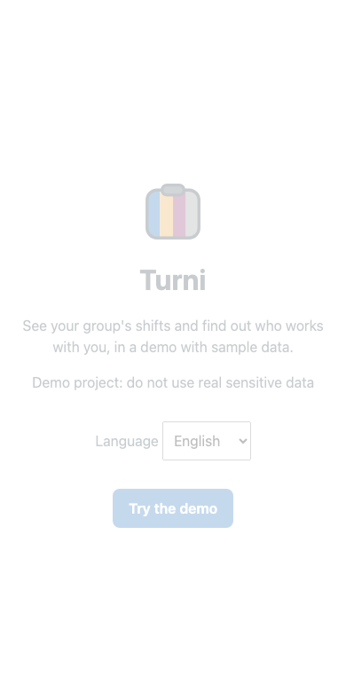
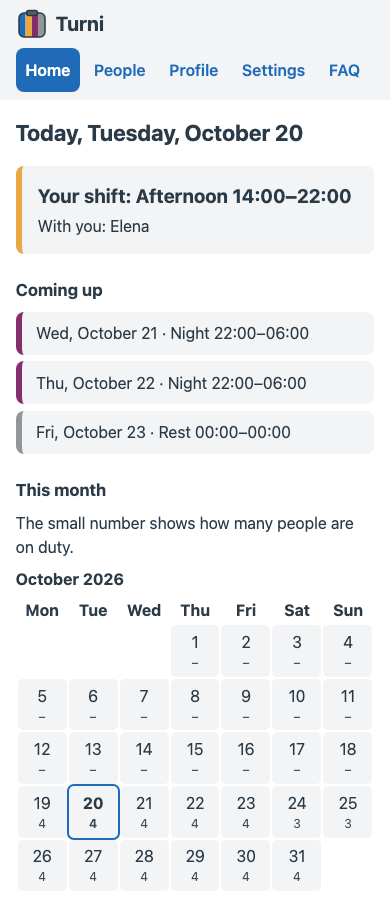

# Turni

A shared shift tracker: see your own shift today, who works with you, your next shifts and how many people work each day of the month. It runs in two ways: a demo on in-memory sample data that needs no setup, and a signed-in mode on Supabase (accounts, groups, invitations and shifts assigned by the group manager).

Live demo: https://mariozefiro.github.io/work-shift-tracker/

<p>
  
  
</p>

## Features

Everything below is in `src/` today.

- Landing page with a "Try the demo" button. The demo has five sample members and an 8-week rotation of morning, afternoon, night and rest shifts.
- Home: today's shift for the demo user, the colleagues on the same shift, upcoming shifts, and a month grid showing how many people work each day.
- People: list of group members with their role.
- Profile: name, role and group of the demo user.
- Settings: language picker, the group's time zone, and a button to leave the demo.
- FAQ page.
- Five interface languages: Italian, English, French, Spanish, German. The choice is stored in `localStorage`; otherwise the browser language is used. The French, Spanish and German translations have not been reviewed by native speakers.
- "Today" follows the group's time zone (`Europe/Rome`), not the browser's, and the home date updates at midnight.
- Accessibility basics: skip link, focus moves to the main area on navigation, labelled lists and table cells, `aria-current` on the active page and day.
- Signed-in mode (needs Supabase, see [Run with Supabase](#run-with-supabase)): sign in with a link sent by email, no password; create groups and switch between them; share a single-use invitation link (valid 7 days, up to 30 members); the group manager assigns or deletes a member's shift, or generates a rotation of three eight-hour shifts for the people picked.

The live site is built without Supabase variables, so it runs the demo only. It is deployed to GitHub Pages by `.github/workflows/deploy.yml` on every push to `main`, after `npm test` passes.

Not built: Google sign-in, shift swaps and voting, notifications, deleting an account, a hosted Supabase project for signed-in mode.

## Note on the night shift in October

The night shift (N) starts at 22:00 and lasts 8 hours. On the night of 24 to 25 October 2026 the clocks in `Europe/Rome` go back one hour, so the app shows 22:00-05:00. That is 8 real hours, even though the clock face shows 7. This is intentional: the roster says "22:00 local, 8 hours", and the app honours it.

## Stack

From `package.json`:

- React `^19.3.1`, React DOM `^19.3.1`
- TypeScript `~7.0.2`
- Vite `^8.3.4` with `@vitejs/plugin-react` `^6.1.2`
- Vitest `^5.0.5`, Testing Library (`@testing-library/react` `^16.3.3`, `@testing-library/jest-dom` `^7.0.1`), jsdom `^30.1.3`
- Supabase: `@supabase/supabase-js` `^2.118.0`, and the Supabase CLI `supabase` `^2.121.0` for the local stack and the pgTAP tests
- Playwright `^1.64.1` with `@axe-core/playwright` `^4.14.0`
- Oxlint `^1.88.0`

No router, i18n or UI library. The reasoning is in `docs/adr/`.

## Three technical decisions

### 1. Pages talk to a `DataSource` interface, not to data

Pages depend on the `DataSource` interface (`src/data/DataSource.ts`): `userId`, `group()` and `shifts({ from, to })`. The demo implements it in memory and returns promises, so loading and error states behave like a network source. Supabase is a second implementation of the same interface (`src/data/supabase/supabaseSource.ts`), built for one group and one user.
Rejected: building pages against a hard-coded fixture. Every page would need rewriting when real data arrives. Cost of my choice: the interface stayed read-only when Supabase arrived, so the writes (assigning shifts, invitations) live in separate modules instead of on the interface. See `docs/adr/0001-datasource-interface-demo-first.md`.

### 2. Dates are UTC instants plus the group's IANA zone, with explicit errors

Shifts cross midnight and DST changes. Shifts are stored as UTC ISO instants, and local times are converted with `Intl` only. An impossible local time throws (`NonexistentLocalTimeError`, `AmbiguousLocalTimeError`) instead of silently shifting by an hour. Day arithmetic works on date strings, not milliseconds.
Rejected: adding 24 hours to a timestamp and parsing local date strings, which give wrong times on the two DST days. Cost: callers must handle the errors, and end times can look odd on those days (see the October note above). See `docs/adr/0003-dates-utc-iana-explicit-errors.md` and `src/lib/cycle.test.ts`.

### 3. Hash routing without a router library

There are five flat pages plus two routes, `invite` and `manage`. `src/app/useRoute.ts` reads `window.location.hash` with `useSyncExternalStore`. The part after `#` never reaches the server, so reloads and deep links work on any static host with no rewrite rules.
Rejected: a router library, which is more dependency than seven flat routes need. Cost: no nested routes, guards or typed params (`params` is a list of strings; only `#/invite/<code>` reads it), and URLs contain `#/`. Revisit if routes become nested. See `docs/adr/0002-hash-routing-without-library.md`.

Four more ADRs cover in-house i18n, the testing strategy, the `useAsync` hook and the Supabase rules (`docs/adr/0007-supabase-row-level-security.md`).

## Run locally

```bash
npm install
npm run dev
```

Other scripts from `package.json`:

```bash
npm run build     # tsc -b && vite build
npm run preview   # serve the production build
npm run lint      # oxlint
```

## Run with Supabase

The demo needs nothing. Signed-in mode needs a container runtime (Docker Desktop, OrbStack, Colima...) for the local stack:

```bash
npx supabase start   # local Postgres, Auth and a mail catcher (http://127.0.0.1:54324)
npx supabase status  # prints the API URL and the publishable key
```

Put the two values in `.env.local` (git-ignored):

```
VITE_SUPABASE_URL=<API URL, http://127.0.0.1:54421 here>
VITE_SUPABASE_PUBLISHABLE_KEY=<publishable key>
```

Then `npm run dev` and open `http://localhost:5173/work-shift-tracker/`. The sign-in link arrives in the local mail catcher. Without those two variables the app starts with the demo only.

Only the publishable key belongs in the browser. A secret or `service_role` key must never go in a `VITE_` variable: it would be public in the built site.

`supabase/config.toml` moves the API port to 54421 (54321 was taken on the author's machine) and allows the sign-in link to return to `http://localhost:5173/work-shift-tracker/`. A hosted project needs its own redirect URL in the dashboard (Authentication, URL Configuration).

## Tests

```bash
npm test          # vitest run: logic and component tests, next to the code in src/
npm run test:e2e  # playwright test: builds the app, serves it on port 4173
npx supabase test db  # pgTAP: access rules and the group and invitation functions (needs the local stack)
```

The end-to-end tests run an axe accessibility check on the landing page and all five pages, and a midnight rollover check using a fake clock. They need the Playwright browsers installed (`npx playwright install`).
